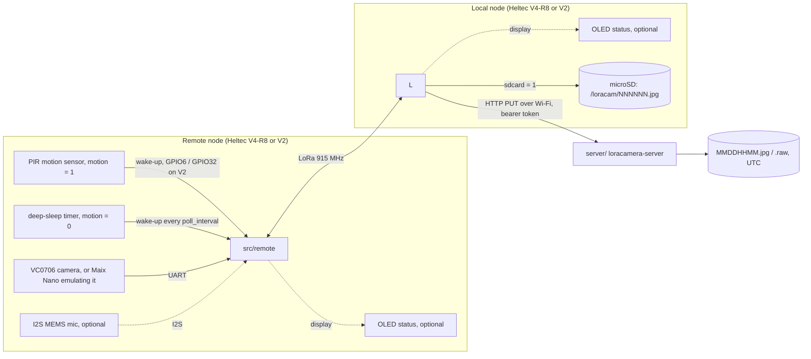

# loracamera documentation

loracamera sends JPEG frames from a serial camera over a point-to-point 915 MHz LoRa link. A second board near Wi-Fi uploads them to a small HTTP server (Rust, shipped as a Docker image). The field board deep-sleeps and wakes either when its PIR motion sensor triggers (the default) or on a timer every `poll_interval` seconds without a PIR ([configuration.md](configuration.md#motion-detection-pir-and-the-timer)). It always starts the transfer; the base station only listens. Microphone audio clips can be added at build time ([configuration.md](configuration.md#audio-capture-optional)); they're off by default.



The remote node spends its time in deep sleep. It wakes on the PIR (`motion = 1`, the default) or, without a PIR (`motion = 0`), on a timer every `poll_interval` seconds, and also takes one picture right after power-on. On each wake-up it captures the picture into RAM, re-encodes it smaller (grayscale at night) and announces it (or, if audio is enabled, alternates between a picture and an audio clip). The local node, which is always listening and never transmits on its own, then pulls it one 250-byte packet at a time and tells the remote it's done, and the remote goes back to sleep. The local node saves each file to its microSD card, then uploads it when Wi-Fi is up. Both nodes can run from a LiPo and a solar panel. The `[loracamera]` options only affect the remote node, so only the remote needs reflashing when they change.

## Contents

| Document | What it covers |
|---|---|
| [hardware.md](hardware.md) | Bill of materials, V4-R8 pin map, RF front end, wiring of both nodes, power and solar sizing, [Heltec V2](hardware.md#heltec-v2) pin map and wiring |
| [getting-started.md](getting-started.md) | Install the toolchain, configure, build, flash, monitor (including WSL2) |
| [configuration.md](configuration.md) | Every tunable: `[loracamera]` options (motion detection, audio, OLED, SD card, camera speed and compression, image re-encoding and night grayscale), radio, TX power, timing, pins, server URL; adding new payload types |
| [usage.md](usage.md) | Running the upload server, deploying the nodes, what you see, the SD card and server files, converting the output |
| [protocol.md](protocol.md) | LoRa packet formats, transfer sequence, retries, airtime and throughput |
| [maix.md](maix.md) | Sipeed Maix Nano (K210) camera: how it emulates the VC0706, setup, the PC probe, bench tests, measurements |
| [troubleshooting.md](troubleshooting.md) | First bring-up checklist and known problems |

## Repository layout

```
platformio.ini            build environments: local, remote (V4-R8); local_v2, remote_v2 (Heltec V2)
src/local/main.cpp        base station: listens for the remote's announcements, pulls the data, saves it, uploads it
src/local/storage.*       microSD card on the base station (sdcard = 1)
src/local/auth.h          your Wi-Fi credentials, SERVER_URL and UPLOAD_TOKEN (not committed, you create it)
src/remote/main.cpp       field side: PIR or timer wake-up and deep sleep, camera (+ optional microphone) capture, announces and serves packets
src/remote/reencode.*     JPEG re-encoding on the ESP32-S3 (quality, night grayscale)
lib/Board/                Board.h (shared link settings, selects the board header) + per-board HeltecV4R8.*, HeltecV2.* (pins, Vext/OLED, radio and its sleep; KCT8103L front end on the V4-R8)
lib/Display/              OLED status screen for both nodes (display / display_v2)
lib/VC0706/               Adafruit VC0706 camera library, slowed down for the ESP32, 32-bit read offset, getVersion() with a timeout (Maix boot polling)
server/                   loracamera-server (Rust): HTTP PUT receiver that saves uploads to disk; Dockerfile, docker-compose.yml
camera/maix/              MaixPy script for the Sipeed Maix Nano camera: main.py (VC0706 emulator), maix_config.py (optional settings)
tools/vc0706_probe.py     PC-side test: takes one picture from a VC0706 or the Maix through a USB-to-TTL adapter (uv run)
```

## Status

The firmware targets the Heltec WiFi LoRa 32 **V4-R8** (HTIT-WBR8H) and builds with PlatformIO. It was ported from the original Heltec V2 / ESP-IDF version, whose base station polled the remote for each picture. That polling mode is gone: there is one protocol, in which the remote wakes (PIR or timer), announces what it captured, and the base station pulls it, with shortened per-packet delays and the picture re-encoded before sending. None of the V4-R8 build has been tested on hardware yet. Use the bring-up checklist in [troubleshooting.md](troubleshooting.md) for the first run.

The **Heltec WiFi LoRa 32 V2** (ESP32 + SX1276) is also supported, as either node, in the `local_v2` / `remote_v2` environments, and V2 and V4-R8 boards can be mixed. It has no PSRAM, so a V2 remote does no re-encoding (`jpeg_quality` and `night_grayscale` are ignored; the camera JPEG is sent as is) and its picture buffer is 72000 bytes instead of 125000. A pair of V2s has run the link, OLED, Wi-Fi upload and timer wake-ups with the built-in test picture; the camera, PIR, SD card and audio on the V2, and mixed pairs, are untested. Wiring and power: [hardware.md](hardware.md#heltec-v2).
