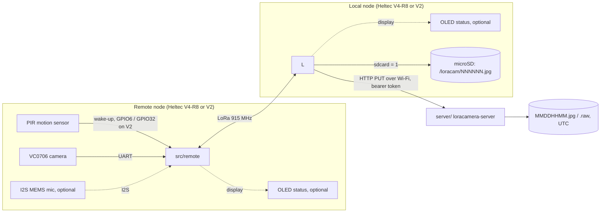

# loracamera documentation

loracamera sends JPEG frames from a serial camera over a point-to-point 915 MHz LoRa link. A second board near Wi-Fi uploads them to a small HTTP server (Rust, shipped as a Docker image). By default the field board sleeps and only takes a picture when its PIR motion sensor triggers ([configuration.md](configuration.md#motion-detection-pir)). Microphone audio clips can be added at build time ([configuration.md](configuration.md#audio-capture-optional)); they're off by default.



With `motion = 1` (the default) the remote node spends its time in deep sleep. When the PIR sees movement it wakes, captures the picture into RAM, re-encodes it smaller (grayscale at night), and announces it; the local node, which is always listening, then pulls it one 250-byte packet at a time and tells the remote it's done, and the remote goes back to sleep. With `motion = 0` (no PIR) the local node asks for the data instead: every `poll_interval` seconds (10 by default) it requests a picture, or alternates between picture and audio if audio is enabled. Either way the local node saves each file to its microSD card, then uploads it when Wi-Fi is up. Both nodes can run from a LiPo and a solar panel.

## Contents

| Document | What it covers |
|---|---|
| [hardware.md](hardware.md) | Bill of materials, V4-R8 pin map, RF front end, wiring of both nodes, power and solar sizing, [Heltec V2](hardware.md#heltec-v2) pin map and wiring |
| [getting-started.md](getting-started.md) | Install the toolchain, configure, build, flash, monitor (including WSL2) |
| [configuration.md](configuration.md) | Every tunable: `[loracamera]` options (motion detection, audio, OLED, SD card, camera speed and compression, image re-encoding and night grayscale), radio, TX power, timing, pins, server URL; adding new payload types |
| [usage.md](usage.md) | Running the upload server, deploying the nodes, what you see, the SD card and server files, converting the output |
| [protocol.md](protocol.md) | LoRa packet formats, transfer sequence, retries, airtime and throughput |
| [troubleshooting.md](troubleshooting.md) | First bring-up checklist and known problems |

## Repository layout

```
platformio.ini            build environments: local, remote (V4-R8); local_v2, remote_v2 (Heltec V2)
src/local/main.cpp        base station: receives (or requests) data, saves it, uploads it
src/local/storage.*       microSD card on the base station (sdcard = 1)
src/local/auth.h          your Wi-Fi credentials, SERVER_URL and UPLOAD_TOKEN (not committed, you create it)
src/remote/main.cpp       field side: PIR wake-up and deep sleep, camera (+ optional microphone) capture, serves packets
src/remote/reencode.*     JPEG re-encoding on the ESP32-S3 (quality, night grayscale)
lib/Board/                Board.h (shared link settings, selects the board header) + per-board HeltecV4R8.*, HeltecV2.* (pins, Vext/OLED, radio and its sleep; KCT8103L front end on the V4-R8)
lib/Display/              OLED status screen for both nodes (display / display_v2)
lib/VC0706/               Adafruit VC0706 camera library, slowed down for the ESP32, 32-bit read offset
server/                   loracamera-server (Rust): HTTP PUT receiver that saves uploads to disk; Dockerfile, docker-compose.yml
```

## Status

The firmware targets the Heltec WiFi LoRa 32 **V4-R8** (HTIT-WBR8H) and builds with PlatformIO. It was ported from the original Heltec V2 / ESP-IDF version. With `motion = 0` the request/packet protocol is unchanged from it, but the per-packet delays were shortened and the picture is now re-encoded before sending; `motion = 1` adds the PIR wake-up, deep sleep and the remote-initiated announcement. None of the V4-R8 build has been tested on hardware yet; the motion mode's transfer logic was only exercised in a host simulation of both nodes. Use the bring-up checklist in [troubleshooting.md](troubleshooting.md) for the first run.

The **Heltec WiFi LoRa 32 V2** (ESP32 + SX1276) is also supported, as either node, in the `local_v2` / `remote_v2` environments, and V2 and V4-R8 boards can be mixed. It has no PSRAM, so a V2 remote does no re-encoding (`jpeg_quality` and `night_grayscale` are ignored; the camera JPEG is sent as is) and its picture buffer is 72000 bytes instead of 125000. The V2 build compiles but has not been tested on hardware, nor have mixed pairs. Wiring and power: [hardware.md](hardware.md#heltec-v2).
