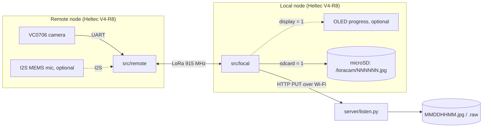

# loracamera documentation

loracamera sends JPEG frames from a serial camera over a point-to-point 915 MHz LoRa link. A second board near Wi-Fi uploads them to a small HTTP server on your PC. Microphone audio clips can be added at build time ([configuration.md](configuration.md#audio-capture-optional)); they're off by default.



The local node asks for the data, and the remote node only ever answers. Every 10 s the local node requests a picture, or alternates between picture and audio if audio is enabled. The remote node captures the picture into RAM, re-encodes it smaller (grayscale at night), and the local node then pulls it one 250-byte packet at a time. The local node saves each file to its microSD card, then uploads it when Wi-Fi is up. Both nodes can run from a LiPo and a solar panel.

## Contents

| Document | What it covers |
|---|---|
| [hardware.md](hardware.md) | Bill of materials, V4-R8 pin map, RF front end, wiring of both nodes, power and solar sizing |
| [getting-started.md](getting-started.md) | Install the toolchain, configure, build, flash, monitor (including WSL2) |
| [configuration.md](configuration.md) | Every tunable: `[loracamera]` options (audio, OLED, SD card, camera speed and compression, image re-encoding and night grayscale), radio, TX power, timing, pins, server URL; adding new payload types |
| [usage.md](usage.md) | Running the upload server, deploying the nodes, what you see, the SD card and server files, converting the output |
| [protocol.md](protocol.md) | LoRa packet formats, transfer sequence, retries, airtime and throughput |
| [troubleshooting.md](troubleshooting.md) | First bring-up checklist and known problems |

## Repository layout

```
platformio.ini            build environments: local, remote
src/local/main.cpp        base station: requests data, saves it, uploads it
src/local/storage.*       microSD card on the base station (sdcard = 1)
src/local/auth.h          your Wi-Fi credentials (not committed, you create it)
src/remote/main.cpp       field side: camera (+ optional microphone) capture, serves packets
src/remote/reencode.*     JPEG re-encoding on the ESP32-S3 (quality, night grayscale)
lib/HeltecV4R8/           board pins, Vext/OLED, KCT8103L front end, SX1262 radio, shared link settings
lib/VC0706/               Adafruit VC0706 camera library, slowed down for the ESP32, 32-bit read offset
server/listen.py          HTTP PUT receiver that saves uploads to disk
```

## Status

The firmware targets the Heltec WiFi LoRa 32 **V4-R8** (HTIT-WBR8H) and builds with PlatformIO. It was ported from the original Heltec V2 / ESP-IDF version. The request/packet protocol is unchanged, but the per-packet delays were shortened and the picture is now re-encoded before sending. None of the V4-R8 build has been tested on hardware yet. Use the bring-up checklist in [troubleshooting.md](troubleshooting.md) for the first run.
