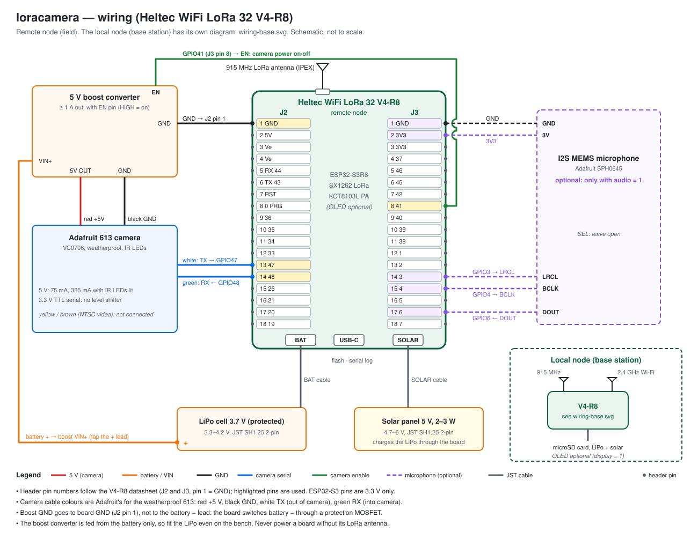
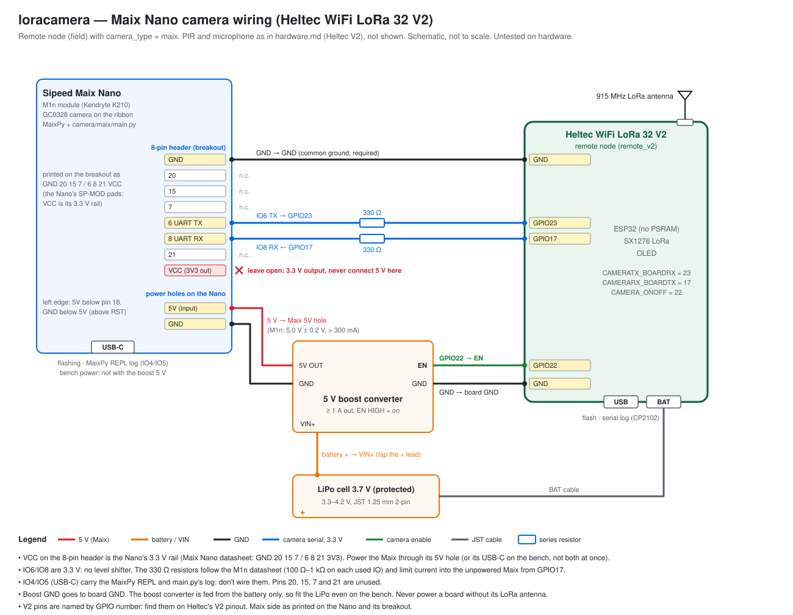
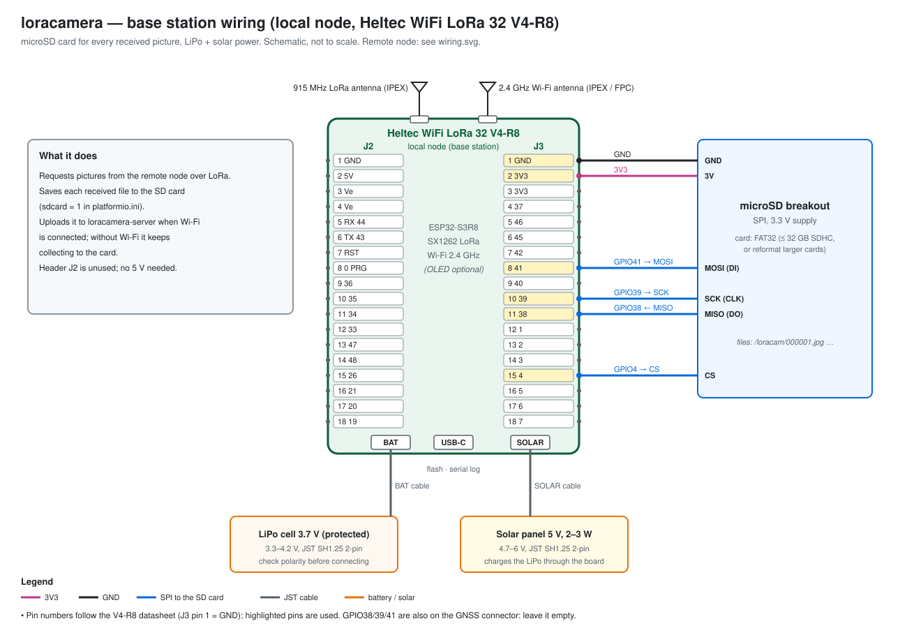

# Hardware

## Bill of materials

Everything in the wiring diagrams ([remote node](#remote-node-wiring), [base station](#base-station-wiring)), plus the cables they imply.

**Both nodes**

| Qty | Part | Notes |
|---|---|---|
| 2 | [Heltec WiFi LoRa 32 V4-R8](https://heltec.org/project/wifi-lora-32-v4/) (HTIT-WBR8H) | ESP32-S3R8 (8 MB PSRAM), 16 MB flash, SX1262, KCT8103L front end. 868–928 MHz high-power model. Sold with or without a 0.96" OLED; the firmware works either way ([configuration.md](configuration.md#oled-display)) |
| 2 | Alternative: [Heltec WiFi LoRa 32 V2](#heltec-v2) | ESP32 (no PSRAM), 8 MB flash, SX1276, 0.96" OLED, CP2102 USB-UART. Can replace the V4-R8 on either node, or be mixed with it. Pins, wiring and limits in [Heltec V2](#heltec-v2). Run as a pair on the bench without camera, PIR or SD card. No solar input (the Solar row below doesn't apply) |
| 2 | 915 MHz LoRa antenna, IPEX (U.FL) connector | One per board. Check whether your kit includes them. Never transmit without an antenna attached |
| 2 | LiPo cell, 3.7 V, with protection circuit | One per node. JST **SH 1.25 mm** 2-pin plug to fit the board. ≥ 3000 mAh on the remote node, larger on the base station (see [sizing](#battery-and-solar-sizing)). Check the plug polarity against the board's BAT marking before connecting: LiPo polarity isn't standardised |
| 2 | Solar panel, 5 V nominal, 2–3 W | One per node. Output must stay within Heltec's 4.7–6 V solar-input range. JST **SH 1.25 mm** 2-pin plug to the board's SOLAR connector |
| 4 | JST SH 1.25 mm 2-pin pigtails | For the batteries and solar panels if they come with other plugs (JST PH 2.0 mm is common) or bare leads |
| 2 | Weatherproof enclosure | One per node: board, battery and (remote) boost converter. Not in the diagrams. The camera has its own housing |
| — | Hook-up wire, female Dupont jumpers or a terminal block, heat-shrink | Camera, boost converter and SD breakout to the 2.54 mm headers |
| 1–2 | USB-C data cable | Flashing and serial log. A charge-only cable won't enumerate |

**Remote node (field)**

| Qty | Part | Notes |
|---|---|---|
| 1 | [Adafruit 613: weatherproof TTL serial JPEG camera with IR LEDs (VC0706)](https://www.adafruit.com/product/613) | 5 V supply, 3.3 V serial, built-in night vision (see [below](#camera-adafruit-613)). Comes with a 1 m cable with bare leads |
| 1 | Alternative camera: Sipeed Maix Nano (M1n module, Kendryte K210) with its GC0328 camera, or an OV2640, on the ribbon | Instead of the Adafruit 613, with `camera_type = maix`. Runs MaixPy and `camera/maix/main.py`, which emulates the VC0706. 5 V into its 5V hole (not the 8-pin header's VCC, which is 3.3 V), 3.3 V serial, **no IR LEDs** (see [below](#camera-sipeed-maix-nano)). Plus two 330 Ω resistors for the serial lines. Untested on hardware |
| 1 | USB-to-TTL serial adapter, 3.3 V logic (bench only) | Maix camera only: to run `tools/vc0706_probe.py` against the Maix from a PC before wiring it to the Heltec ([maix.md](maix.md#test-2-emulator-check-from-a-pc)) |
| 1 | 5 V boost converter module | ≥ 1 A out, input range covering 3.0–4.2 V, **enable pin that is active-high and accepts 3.3 V logic** (driven by GPIO41 on the V4-R8, GPIO22 on the V2). Wiring in [Power](#power) |
| 1 | Battery + tap for the boost converter | A Y-split on the battery's + lead, or a soldered tap. The board's headers don't expose the battery voltage |
| 1 | PIR motion sensor, 3.3 V supply and output, e.g. AM312 | **With `motion = 1` (default)**. Runs from 2.7–12 V on the always-on `3V3` pin; output HIGH (3.3 V) while it sees motion. The HC-SR501 needs ≥ 4.5 V, which a battery-powered board doesn't have. A PIR can't see through glass or clear plastic: mount its lens outside the enclosure, aimed where the camera looks ([wiring](#motion-sensor-pir)) |
| 1 | [Adafruit I2S MEMS microphone (SPH0645)](https://www.adafruit.com/product/3421) | **Only if built with `audio = 1`**, which needs `motion = 0` ([configuration.md](configuration.md#audio-capture-optional)) |

**Base station (local node) and server**

| Qty | Part | Notes |
|---|---|---|
| 1 | microSD breakout, SPI, **3.3 V** | E.g. [Adafruit 4682](https://www.adafruit.com/product/4682) (3 V only) or [Adafruit 254](https://www.adafruit.com/product/254) (3–5 V). Avoid cheap modules with an AMS1117 regulator: they need 5 V, which a battery-powered board doesn't have. Wiring: [Base station wiring](#base-station-wiring) |
| 1 | microSD card, FAT32 | SDHC up to 32 GB comes FAT32. The firmware can't read exFAT, so reformat 64 GB+ cards (SDXC) as FAT32. 1 GB holds roughly 50,000 re-encoded 20 KB pictures |
| 1 | 2.4 GHz Wi-Fi antenna | Heltec's case version integrates an FPC 2.4 GHz antenna on the second IPEX connector. A bare board needs an IPEX 2.4 GHz antenna |
| 1 | USB-C 5 V supply, ≥ 500 mA (optional) | Bench power, or mains power instead of the solar panel |
| 1 | Upload server | Runs `loracamera-server` (Docker image `gfnord/loracamera-server`) and receives the uploads: a computer on the same LAN or an internet host ([usage.md](usage.md#1-run-the-upload-server)). Optional: without Wi-Fi the base station keeps collecting to the SD card |

Heltec's V4-R8 datasheet (`WiFi_LoRa_32_V4R8.pdf`) and schematic (`HTIT-WBR8H_V4.3.2.pdf`) are the sources for this page. Heltec's copyright notice doesn't allow redistributing them, so they aren't committed. Get them from Heltec support or the product page.

## V4-R8 pin map

Pins used by the board itself. The board and project pins are defined in `lib/Board/HeltecV4R8.h` (shared link settings are in `lib/Board/Board.h`). The V2's are in [Heltec V2](#heltec-v2).

| Function | GPIO | Notes |
|---|---|---|
| SX1262 NSS / SCK / MOSI / MISO | 8 / 9 / 10 / 11 | |
| SX1262 RESET / BUSY / DIO1 | 12 / 13 / 14 | DIO1 is the IRQ line; there is no DIO0 on the SX1262 |
| SX1262 TCXO | (SX1262 DIO3) | 32 MHz TCXO powered from DIO3, driven at 1.8 V |
| Front end power `VFEM_Ctrl` | 7 | Enables the FEM LDO (TLV75733); HIGH = on |
| Front end enable `PA_CSD` | 2 | HIGH = on |
| Front end mode `PA_CTX` | 5 | HIGH while transmitting, LOW for LNA receive |
| Front end `PA_CPS` | (SX1262 DIO2) | Switched by the radio (DIO2 as RF switch) |
| Vext control | 40 | P-MOSFET gate: **LOW = Vext on**. Vext feeds the OLED and the two `Ve` header pins |
| OLED SDA / SCL / RST | 17 / 18 / 21 | SSD1315, I2C address 0x3C, SSD1306-compatible. Driven on either node only when built with `display = 1`; free GPIOs otherwise |
| LED (white) | 46 | Also a strapping pin; unused by the firmware |
| PRG button | 0 | Hold at reset to enter the ROM bootloader |
| Battery voltage | 1 | 390K/100K divider, always connected; unused by the firmware |
| USB D− / D+ | 19 / 20 | Native USB; the board has **no** USB-UART bridge |
| GNSS connector | 38, 39, 41, 42 | Free when no GNSS module is plugged in |
| Not usable | 26, 33–37 | Used by the octal PSRAM inside the ESP32-S3R8 |

> **TFT version.** The V4-R8 is also sold with a 240×320 TFT on the same display connector. Per Meshtastic's V4-R8 TFT build it uses GPIO15, 16, 44, 45, 47, 48, 21 and touch I2C on 17/18. GPIO47/48 are the camera UART here, so this firmware doesn't support the TFT version on the remote node.

> **Datasheet errata.** Section 3.3 of the V4-R8 datasheet says to pull `VextCtrl(GPIO40)` high to enable Vext. The schematic shows it driving the gate of a P-channel MOSFET (Q2, AO3401A) pulled up to 3.3 V, so HIGH turns Vext **off**. The firmware drives it LOW. The datasheet's `ADC_CTRL(37)` footnote and the GPIO33–37 header entries were carried over from the 2 MB-PSRAM V4. On the R8 those pins are not connected.

### RF front end (KCT8103L)

From the KCT8103L truth table:

| Mode | CSD (GPIO2) | CTX (GPIO5) | CPS (DIO2) |
|---|---|---|---|
| Transmit (PA) | 1 | 1 | 1 |
| Receive (LNA) | 1 | 0 | X |
| Receive bypass | 1 | 1 | 0 |
| Shutdown | 0 | X | X |

`radioBegin()` powers the front end (GPIO7 HIGH, GPIO2 HIGH, GPIO5 LOW). `radioSend()` raises GPIO5 for the duration of each transmission, and the SX1262 drives CPS through DIO2 itself.

## Remote node wiring

All peripherals use free header GPIOs. The ESP32-S3 pins are **3.3 V only and not 5 V tolerant**. The diagram and the tables in this section are for the V4-R8; V2 wiring is in [Heltec V2](#heltec-v2).

| Peripheral pin | V4-R8 pin | Define in `lib/Board/HeltecV4R8.h` |
|---|---|---|
| Camera TX (out of camera) | GPIO47 (header J2) | `CAMERATX_BOARDRX` |
| Camera RX (into camera) | GPIO48 (header J2) | `CAMERARX_BOARDTX` |
| Camera power switch control | GPIO41 (header J3) | `CAMERA_ONOFF` |
| PIR VCC / GND (`motion = 1`) | 3V3 (J3 pin 2) / GND (J3 pin 1) | |
| PIR OUT (`motion = 1`) | GPIO6 (J3 pin 17) | `MOTION_PIR` |
| Mic BCLK (`audio = 1` only) | GPIO4 (header J3) | `I2S_BCK` |
| Mic LRCL / WS (`audio = 1` only) | GPIO3 (header J3) | `I2S_LRC` |
| Mic DOUT (`audio = 1` only) | GPIO6 (header J3) | `I2S_DIN`. Same pin as the PIR: `audio = 1` needs `motion = 0` |
| Mic 3V / GND (`audio = 1` only) | 3V3 / GND | |
| Mic SEL (`audio = 1` only) | leave unconnected | see [troubleshooting](troubleshooting.md#audio-is-silent-or-noise) if audio is silent |

`CAMERA_ONOFF` is a logic signal (HIGH = camera on), not a supply. It drives the enable pin of the 5 V boost converter that feeds the camera (see [Power](#power)). The firmware switches the camera on before each picture and off afterwards. Cutting the power also returns the camera's serial speed to 38400 baud, which the firmware expects at power-up (it copes if the power isn't actually cut).

### Motion sensor (PIR)

With `motion = 1` (the default) the remote node spends its time in deep sleep. The PIR output wakes it: the ESP32-S3 can only wake from deep sleep on an RTC-capable pin (GPIO0–21), which rules out the free GNSS-header pins. GPIO6 is the RTC pin left on the headers once the radio front end, the battery divider and USB are accounted for; it's also the microphone's data pin, so the microphone and the PIR are exclusive.

- **Power it from `3V3`**, which stays on while the board sleeps. `Ve` is switched off before sleeping.
- **Output:** HIGH = motion. The firmware wakes on a HIGH level and enables the ESP32's internal pull-down on GPIO6, so an unplugged sensor doesn't wake the board.
- **Warm-up:** PIR sensors need from a few seconds to a minute after power-up to settle and may trigger during that time. Expect a picture or two right after the battery is connected.
- **Retriggering:** after each picture the PIR stays disarmed for `motion_cooldown` seconds (default 60, [configuration.md](configuration.md#motion-detection-pir-and-the-timer)). If the output is still HIGH when the cool-down ends, the remote wakes at once and takes the next picture. Continuous motion therefore gives one picture per cool-down plus capture-and-transfer cycle (~40 s): about 36 an hour with the default, ~90 an hour with `motion_cooldown = 0`.
- **Delay:** the picture is taken about 3–4 s after the PIR triggers (boot, camera power-up and its fixed delays) [estimate]. A subject crossing the field of view quickly may be gone; aim the PIR where subjects linger or approach the camera.
- **Field of view:** the camera sees 60°, a typical PIR lens 100° or more. Mask or aim the PIR so it doesn't trigger on motion the camera can't see.

### Camera (Adafruit 613)

From Adafruit's product sheet:

| Item | Value |
|---|---|
| Chip | VC0706 camera processor, 1/4" CMOS sensor (0.3 MP) |
| Output | JPEG at 640×480, 320×240 or 160×120 |
| Serial | 3.3 V TTL (TX, RX, GND): connects straight to GPIO47/48, no level shifter. 38400 baud at power-up, 115200 maximum (see [configuration](configuration.md#camera)) |
| Supply | **5 V** |
| Current | 75 mA, plus 250 mA while the IR LEDs are on |
| Night vision | Ring of 12 IR LEDs, switched on automatically by an onboard photocell when it's dark. The firmware can't control them |
| Range | About 10 m, 15 m maximum |
| View angle | 60° |
| Housing | Weatherproof metal case with a mounting hinge and a 1 m cable (TTL and NTSC video wires) |

The NTSC video output is unused.

### Camera: Sipeed Maix Nano

An alternative to the Adafruit 613: a Sipeed Maix Nano with its Sipeed M1n module (Kendryte K210, dual-core RISC-V at 400 MHz, 8 MB RAM) and the DVP camera on its ribbon: Sipeed ships the Nano with a GC0328 (0.3 MP); an OV2640 also works (main.py detects and logs which). It runs MaixPy and [`camera/maix/main.py`](../camera/maix/main.py), which answers the VC0706 serial protocol, so it uses the Adafruit 613's signals and the same firmware calls. Build the remote with `camera_type = maix`. Setup, the PC probe, the bench tests and the measurements still to take: [maix.md](maix.md). **Untested on hardware.** Sources: [Maix Nano wiki page](https://wiki.sipeed.com/soft/maixpy/en/develop_kit_board/maix_nano.html), Maix Nano and M1n datasheets ([dl.sipeed.com](https://dl.sipeed.com/shareURL/MAIX/HDK/Sipeed-M1n)).

The Nano's 8-pin header (Sipeed's SP-MOD pads, often brought out on a breakout) is printed **GND 20 15 7 / 6 8 21 VCC**. Only GND, 6 and 8 are used. **VCC there is the Nano's 3.3 V rail, not a supply input** (the datasheet labels it 3V3): leave it open and never connect 5 V to it. The 5 V input is the **5V hole** on the Nano's left edge (below pin 18, with GND below it), or its USB-C port.

| Maix Nano pin | V2 pin | V4-R8 pin | Define in the board header |
|---|---|---|---|
| 6 (8-pin header): IO6, UART TX, out of the Maix | GPIO23, through 330 Ω | GPIO47 (header J2), through 330 Ω | `CAMERATX_BOARDRX` |
| 8 (8-pin header): IO8, UART RX, into the Maix | GPIO17, through 330 Ω | GPIO48 (header J2), through 330 Ω | `CAMERARX_BOARDTX` |
| GND (8-pin header) | board GND | board GND (J2 pin 1) | |
| 5V hole (left edge) | boost converter output +, EN from GPIO22 | boost converter output +, EN from GPIO41 | `CAMERA_ONOFF` |
| GND hole (left edge, below 5V) | boost converter output − | boost converter output − | |
| VCC (8-pin header), 20, 15, 7, 21 | not connected | not connected | |

- **3.3 V logic** on IO6/IO8: no level shifter. The M1n datasheet asks for 100 Ω–1 kΩ in series with every IO used; 330 Ω also limits the current the Heltec's TX (GPIO17/48, idle HIGH) pushes into the Maix while it's unpowered.
- IO6/IO8 are mapped by the FPIOA in main.py (`PIN_TX`, `PIN_RX`). **Never use IO4/IO5**: they are the Maix's USB/ISP UART and the MaixPy REPL, which carries main.py's log.
- For the bench tests the Maix can run from its own USB-C, with its GND tied to the Heltec's GND and the boost converter's 5 V **disconnected**: don't feed the 5V hole and USB-C at once ([maix.md](maix.md#test-3-heltec-v2-bench)).

| Item | Sipeed Maix Nano | Adafruit 613 |
|---|---|---|
| Output | JPEG encoded by main.py at 640×480, 320×240 or 160×120 (`maix_resolution`, `maix_resolution_v2`) | JPEG at 640×480, 320×240 or 160×120 |
| JPEG quality | `camera_compression` mapped to quality 10–90; re-encoded on the Maix to stay under `max_jpeg_bytes` (60000) | Compression register |
| Start-up | MaixPy boot, 2–4 s [estimate]; the remote polls until it answers (up to 10 s) | Fixed 1 s delay |
| Supply at 5 V | 5.0 V ± 0.2 V, more than 300 mA available (M1n datasheet; Maix Nano datasheet: > 1.5 W). Actual draw not measured | 75 mA, 325 mA with the IR LEDs lit |
| Night vision | **None**: no IR LEDs, no IR-cut filter control | 12 IR LEDs switched by a photocell |
| Housing | None: needs its own weatherproof enclosure with a window for the lens | Weatherproof metal case |
| Software | MaixPy-v1, in maintenance mode (below) | Fixed firmware |

**No night vision.** The Maix has no IR LEDs, and the firmware doesn't drive an IR-cut filter. At night pictures depend on ambient light (street lights, moonlight, a lamp) and are mostly black or very noisy. Use the Adafruit 613 where night pictures matter. `night_grayscale` still applies on a V4-R8: dark frames are near-colourless, so they go out as small grayscale JPEGs.

**Power.** The Maix draws more than the Adafruit 613 by day and is on longer per picture (the MaixPy boot), but there's no IR surge at night. The boost converter (≥ 1 A out) covers the datasheets' 300 mA comfortably; keep its output within 4.8–5.2 V, the M1n's supply range. Per picture, all [estimate] until measured ([maix.md](maix.md#measurements)), planning with 150 mA up to the datasheet's 300 mA:

| | V2, 320×240 | V4-R8, 640×480 |
|---|---|---|
| Maix on: boot + configuration + 1 s resume + capture and encoding + readout | ~8–15 s | ~13–30 s |
| Battery current for the Maix (150–300 mA at 5 V, boost ~85 % efficient from 3.7 V) | ~240–480 mA | ~240–480 mA |
| Charge for the camera | ~0.5–2.0 mAh | ~0.9–4.0 mAh |
| Adafruit 613 for comparison (13 s, [worked example](#battery-and-solar-sizing)) | 0.43 mAh by day, 1.9 mAh at night | 0.43 mAh by day, 1.9 mAh at night |

The Heltec's own awake time changes little: it waits for the MaixPy boot instead of a fixed 1 s, but saves ~6 s of reply time-outs (main.py pads its get-version and set-port replies, [maix.md](maix.md#how-it-works)). So by day a picture costs up to ~1.6 mAh more on a V2 and up to ~3.6 mAh more on a V4-R8 than with the Adafruit 613; at night between a little less and ~2 mAh more [estimate]. Measure the Maix's current with a USB power meter before sizing the battery.

**MaixPy is in maintenance mode.** Sipeed now develops MaixPy v4 for its MaixCAM boards, which doesn't support the K210, and says the K210 series is being phased out ([Sipeed wiki](https://wiki.sipeed.com/soft/maixpy/en)). MaixPy-v1, the K210 version, last released v0.6.3 in May 2024 ([MaixPy-v1](https://github.com/sipeed/MaixPy-v1)). Expect no new features; keep copies of the firmware and tools that work.

## Base station wiring

The base station (local node) saves every received file to a microSD card (`sdcard = 1`, the default; see [configuration.md](configuration.md#sd-card-base-station)). It runs from its own LiPo and solar panel, connected exactly like on the remote node. The diagram and table below are for the V4-R8; for the V2 see [Heltec V2](#heltec-v2).

| SD breakout pin | V4-R8 pin | Define in `lib/Board/HeltecV4R8.h` |
|---|---|---|
| GND | GND (J3 pin 1) | |
| 3V / VCC | 3V3 (J3 pin 2) | |
| CS | GPIO4 (J3 pin 15) | `SD_CS` |
| SCK / CLK | GPIO39 (J3 pin 10) | `SD_SCK` |
| MISO / DO | GPIO38 (J3 pin 11) | `SD_MISO` |
| MOSI / DI | GPIO41 (J3 pin 8) | `SD_MOSI` |

- The card uses its own SPI bus (the ESP32-S3's second general-purpose SPI controller, `HSPI` in Arduino), so it never shares wires with the LoRa radio.
- GPIO38, 39 and 41 are also on the board's GNSS connector. Leave that connector empty on the base station.
- Power the breakout from **3V3**, not from `Ve` or `5V`. `5V` only exists on USB power, and `Ve` is switched by the firmware.

## Power

This section and its battery sizing are for the V4-R8. The V2 differs: see [Heltec V2](#heltec-v2).

| Source | Notes |
|---|---|
| USB-C 5 V | Development; also charges the LiPo |
| LiPo, JST SH1.25 2-pin | 3.3–4.2 V; the remote node in the field |
| Solar, JST SH1.25 2-pin | 4.7–6 V; charges the LiPo |
| `Ve` pins | Switched 3.3 V output (Vext), up to 500 mA; on while the firmware runs, off while the remote node sleeps |
| `3V3` pins | Always-on 3.3 V. Powers the PIR |

Current draw (datasheet, USB powered):

| State | Current |
|---|---|
| LoRa receive | ~75 mA |
| LoRa TX, 17 dBm | ~330 mA |
| LoRa TX, 22 dBm | ~400 mA |
| LoRa TX, 27 dBm | ~750 mA |
| Wi-Fi active | 120–170 mA |
| Camera on, daylight (5 V) | 75 mA |
| Camera on, dark: IR LEDs lit (5 V) | 325 mA |

The camera needs **5 V**, and only while a picture is taken: about 4 s of fixed start-up and power-off delays plus the image readout. On USB power the board's `5V` pin can supply it. Heltec rates that 5 V output for 500 mA, and the schematic feeds it straight from USB (VUSB → fuse → `VDD_5V`). On a LiPo there is no 5 V rail, so add a 5 V boost converter for the camera, wired as in the [diagram](#remote-node-wiring):

- **VIN+** from the battery + lead (a Y-split of the battery cable). The board's headers don't expose the battery voltage.
- **GND** to board GND (J2 pin 1), not to the battery − lead: the board switches battery − through a protection MOSFET (Q4).
- **EN** from GPIO41 (`CAMERA_ONOFF`, J3 pin 8). Pick a module whose enable input is active-high and accepts 3.3 V logic, rated for at least 1 A out (325 mA at 5 V with the IR LEDs lit, plus start-up surge).

Because the boost converter is fed from the battery only, fit the LiPo even when testing on USB.

The default TX setting gives about 20 dBm at the antenna (see [configuration.md](configuration.md#tx-power)). In both `motion` modes the remote node deep-sleeps between pictures: the SX1262 is put to sleep, the RF front end and Vext are switched off, and GPIO41 is held LOW so the camera stays off. It wakes on the PIR (`motion = 1`) or on a timer every `poll_interval` seconds (`motion = 0`).

### Battery and solar sizing

All figures are estimates from the datasheet currents above, not measurements.

- **Charging is capped at about 540 mA.** The board's charger (CN3165) sets its current with R13 = 2.2 kΩ, I = 1188 / R13 per the schematic, and the solar input goes through the same charger. A 5 V panel of about 2.7 W can deliver that, so a bigger panel only helps in weak light. With ~5 h of good sun that's at most ~2.7 Ah per day.
- **Each picture adds ~2–3 mAh:** camera on for ~13 s (more at night, with the IR LEDs), then ~16 s of transmitting a ~20 KB re-encoded image at SF7.

**With `motion = 1` (default)** the remote only draws current when something moves:

- **Asleep:** the ESP32-S3 in deep sleep with the RTC peripherals on (for the PIR pin's pull-down), the SX1262 in sleep, the front end off, plus the PIR (AM312: ~15 µA) and the always-connected battery divider (~9 µA at 4.2 V). Tens of µA in total, **about 1–2 mAh per day** [estimate, not measured; the board's own regulator and charger leakage aren't documented].
- **Per motion event: ~2–3 mAh,** as above, plus up to a few seconds of receive while the base station finishes.
- So 100 events a day cost about 0.3 Ah, which a 2–3 W panel covers easily, and a 3000 mAh cell rides out about 10 sunless days at that rate. Continuous motion (a busy path, branches moving in the wind or sun on them) retriggers as soon as each `motion_cooldown` ends: with the default 60 s, up to ~36 pictures an hour (~0.1 Ah per hour); with `motion_cooldown = 0`, ~90 an hour (~0.2 Ah). Raise `motion_cooldown` and aim and mask the PIR accordingly.

**Worked example: 5 pictures a day (`motion = 1`).** Charge per picture, for a ~20 KB re-encoded image (80 packets) at the default SF7 and TX power:

| Part of the cycle | Current × time | Day | Night (IR LEDs) |
|---|---|---|---|
| Board awake in receive: boot, camera start-up, ~10 s image readout at 115200 baud, re-encoding, ~19 s transfer | ~75 mA × ~35 s | 0.73 mAh | 0.73 mAh |
| Camera on, 5 V through the boost converter (~85 % efficient, 3.7 V cell) | ~120 mA (day) / ~520 mA (night) × ~13 s | 0.43 mAh | 1.9 mAh |
| Transmitting the data packets, on top of receive | (~330 − 75) mA × 80 × 0.2 s | 1.1 mAh | 1.1 mAh |
| **Per picture** | | **~2.3 mAh** | **~3.7 mAh** |

| Daily budget | 3000 mAh LiPo | 2 × 18650, 2500 mAh, in parallel (5000 mAh) |
|---|---|---|
| 5 pictures (all daytime … all at night) | 11.5–18.5 mAh | 11.5–18.5 mAh |
| Deep sleep, 24 h | 1–2 mAh | 1–2 mAh |
| Self-discharge, ~2–3 % of capacity a month | 2–3 mAh | 3.5–5 mAh |
| **Total per day** | **~15–24 mAh** | **~16–26 mAh** |
| Usable charge (~80 %: protection cut-off, cold, ageing) | ~2400 mAh | ~4000 mAh |
| **Runtime without any sun** | **~100–160 days (3–5 months)** | **~155–250 days (5–8 months)** |

- Self-discharge and sleep current are a quarter to a third of the daily budget, and self-discharge grows with capacity, so a bigger battery gains a little less than its size suggests: the 18650 pair has 1.7× the charge of the LiPo but lasts ~1.6× as long.
- **The two 18650s must be in parallel (1S2P, 3.7 V).** The board's battery input takes a single cell, 3.3–4.2 V; two cells in series (7.4 V) would destroy it. Use two cells of the same model at the same voltage before joining them, a holder or a 1S protection board (bare 18650s often have no protection circuit), and a JST SH 1.25 mm lead to the board's battery connector. The boost converter's VIN+ tap goes on the pack's + lead, as with the LiPo.
- Recharging a flat 5000 mAh pack at the ~540 mA charging limit takes ~10 hours of good sun, i.e. two or three sunny days with a 2–3 W panel.
- **With solar**, the day's charge is replaced by 2–3 minutes at the ~540 mA charging limit, so even an overcast day keeps the battery full. Any 5 V panel within the charger's 4.7–6 V input works; the 2–3 W panel in the BOM is far more than this needs, but helps in winter and under canopy.
- **False triggers dominate.** One hour of continuous retriggering (~36 pictures with the default 60 s `motion_cooldown`, ~0.1 Ah) uses as much as 5 days of this budget. If the SD card shows many empty frames, re-aim or mask the PIR, or raise `motion_cooldown`, before buying a bigger battery.
- These are estimates from datasheet currents: the receive and TX figures were measured by Heltec on USB power, TX at 17 dBm (the default setting gives ~20 dBm at the antenna), and the sleep current isn't measured at all. Check them with a USB power meter or a µA meter on the battery lead.

**With `motion = 0`** the remote node also deep-sleeps between pictures, waking on a timer every `poll_interval` seconds (and taking one picture right after power-on). It no longer sits in receive mode, so the ~75 mA around the clock (~1.8 Ah per day) of the earlier polling design is gone. The daily cost is the number of pictures times the per-picture charge of the worked example below (~2.3 mAh by day, ~3.7 mAh at night), plus the sleep current (~1–2 mAh per day):

| `poll_interval` | Pictures a day | Charge a day [estimate] | Runtime without sun, 3000 mAh LiPo (~2400 mAh usable) [estimate] |
|---|---|---|---|
| `600` (10 min) | 144 | ~0.33–0.53 Ah | ~4–7 days |
| `3600` (1 h, the `platformio.ini` default) | 24 | ~55–90 mAh | ~25–40 days |

The picture count is `86400 / poll_interval`; since `poll_interval` is the sleep after each capture and transfer ends (about a minute), the real count is a little lower. The runtime column adds ~2–3 mAh a day of self-discharge. A 2–3 W panel covers either row on sunny days; use a larger cell to bridge longer cloudy spells. As with `motion = 1`, these are estimates from datasheet currents: the timer mode has run on two Heltec V2 boards, but no current has been measured.

Pick `poll_interval` from the battery budget: charge a day ≈ (86400 / `poll_interval`) × 2.3–3.7 mAh + 1–2 mAh.

**Base station.** It never sleeps: it always listens, because the remote can announce a picture at any moment (PIR or timer), and it never transmits except to request packets and send "done". LoRa receive (~75 mA) plus Wi-Fi. The firmware keeps Wi-Fi connected with the core's default modem-sleep power saving, which adds on average a few tens of mA [estimate]; active transmission draws 120–170 mA. SD writes are brief. That puts the base station around **2.5–3.5 Ah per day** [estimate], at or above the ~2.7 Ah a solar panel can put back through the charger. So:

- use a larger cell (6000 mAh or more) to ride out cloudy days, and expect the battery to run down slowly in poor weather;
- if Wi-Fi isn't reachable, the driver keeps retrying in the background, which costs power without uploading anything;
- a USB supply removes the constraint where mains power is available.

## Heltec V2

The Heltec WiFi LoRa 32 V2 can run either node, alone or mixed with a V4-R8 (e.g. V2 remote + V4-R8 local; same link settings, and sync word 0x12 is the same on air for the SX1262 and SX1276). **Run as a pair on the bench**: LoRa link, OLED, Wi-Fi upload, deep sleep with timer wake-ups (`motion = 0`) and the built-in test picture work; the camera, PIR wake-up, SD card and audio haven't been run on a V2 yet, nor have mixed pairs. Build and flash with the `remote_v2` and `local_v2` environments (`pio run -e remote_v2 -t upload`, `pio run -e local_v2 -t upload`); plain `pio run` builds only the V4-R8 environments. Pins are defined in `lib/Board/HeltecV2.h`. The wiring diagrams in `docs/images` are V4-R8 only, except `wiring-maix-v2.svg` (Maix Nano camera on a V2, [below](#camera-sipeed-maix-nano)). This page refers to V2 pins by GPIO number only.

| Item | V2 |
|---|---|
| MCU | ESP32-D0WDQ6, **no PSRAM**, 8 MB flash (`default_8MB.csv`, 3.2 MB app slot) |
| Radio | SX1276 on PA_BOOST, no external amplifier or front end |
| Display | 0.96" OLED, SSD1306 |
| USB | CP2102 USB-UART (`/dev/ttyUSB0` on Linux; Windows and older macOS need the CP210x driver), auto-reset for flashing, upload speed 460800 |
| Battery | LiPo connector (JST 1.25) with charger. **No solar input** |
| Static RAM (from `pio run`, `display_v2 = 1`) | `local_v2` 120804 B, `remote_v2` 96644 B of 327680. Runtime heap (Wi-Fi, HTTP) not measured on hardware |

### V2 pin map

Pins used by the board itself.

| Function | GPIO | Notes |
|---|---|---|
| Vext control | 21 | **LOW = Vext on**. Feeds the OLED and the `Ve` header pins |
| LED | 25 | |
| OLED SDA / SCL / RST | 4 / 15 / 16 | Status screen on either node, on by default (`display_v2 = 1`) |
| SX1276 NSS | 18 | |
| SX1276 SCK / MOSI / MISO | 5 / 27 / 19 | |
| SX1276 RESET | 14 | |
| SX1276 DIO0 | 26 | RX/TX-done interrupt |
| SX1276 DIO1 | 35 | |

### V2 remote node wiring

| Peripheral pin | V2 pin | Define in `lib/Board/HeltecV2.h` |
|---|---|---|
| Camera TX (out of camera) | GPIO23 | `CAMERATX_BOARDRX` |
| Camera RX (into camera) | GPIO17 | `CAMERARX_BOARDTX` |
| Camera power switch control | GPIO22 | `CAMERA_ONOFF` |
| PIR VCC / GND (`motion = 1`) | 3V3 / GND | |
| PIR OUT (`motion = 1`) | GPIO32 | `MOTION_PIR` |
| Mic BCLK (`audio = 1` only) | GPIO13 | `I2S_BCK` |
| Mic LRCL / WS (`audio = 1` only) | GPIO12 | `I2S_LRC` |
| Mic DOUT (`audio = 1` only) | GPIO39 | `I2S_DIN`. Input-only pin |
| Mic 3V / GND (`audio = 1` only) | 3V3 / GND | |
| Mic SEL (`audio = 1` only) | leave unconnected | |

Camera, camera boost converter and microphone are as on the V4-R8 ([Remote node wiring](#remote-node-wiring), [Power](#power)): `CAMERA_ONOFF` (GPIO22) is a HIGH-on logic signal driving the boost converter's enable pin. The camera UART and I2S pins match the original V2 build; only the camera switch moved (see below). ESP32 pins are 3.3 V only. For the Sipeed Maix Nano camera there's a V2 diagram, `images/wiring-maix-v2.svg` ([Camera: Sipeed Maix Nano](#camera-sipeed-maix-nano)).

### V2 base station wiring

| SD breakout pin | V2 pin | Define in `lib/Board/HeltecV2.h` |
|---|---|---|
| GND | GND | |
| 3V / VCC | 3V3 | |
| CS | GPIO23 | `SD_CS` |
| SCK / CLK | GPIO22 | `SD_SCK` |
| MISO / DO | GPIO33 | `SD_MISO` |
| MOSI / DI | GPIO17 | `SD_MOSI` |

Power the breakout from **3V3**. The OLED (`display_v2 = 1`, default) uses GPIO4/15/16 plus Vext (GPIO21).

### V2 motion sensor (PIR)

- **Output on GPIO32**, an RTC GPIO with an internal pull-down, so it can wake the ESP32 from deep sleep: wake on HIGH (ext1). The pull-down means an unplugged sensor doesn't wake the board.
- **Power it from `3V3`.**
- On the V2 the microphone and the PIR do **not** share a pin, but `audio = 1` still needs `motion = 0` (firmware rule).
- Warm-up, retriggering, delay and field of view: as for the V4-R8 ([Motion sensor](#motion-sensor-pir)).

### V2 strapping pins

- **GPIO12** (mic LRCL / WS) is a strapping pin (MTDI, selects the flash voltage): nothing may pull it HIGH at reset. With `audio = 1`, check that the microphone doesn't drive it HIGH while the board resets.
- **GPIO2** is also a strapping pin, so the camera power switch is on **GPIO22**, not GPIO2 as in the original V2 build: a boost-converter EN pulled up on GPIO2 would block flashing.

### V2 radio

| Item | V2 |
|---|---|
| Chip | SX1276, PA_BOOST, no front end, no TCXO setting |
| TX power (`LORA_TX_POWER_DBM`) | 17 dBm: the PA_BOOST maximum for continuous use. 20 dBm is rated only for 1 % duty cycle, which picture transfers exceed. The original V2 build used 20 dBm |
| Over-current limit (`LORA_CURRENT_LIMIT_MA`) | 100 mA. RadioLib's 60 mA default would clip 17 dBm (~90 mA) |
| Link settings | Same as the V4-R8: 915 MHz, 250 kHz, SF7, CR 5 (`lib/Board/Board.h`, see [configuration.md](configuration.md#radio-link)) |

A V2 transmits about 3 dB less than a V4-R8 at its default (~20 dBm at the antenna).

### V2 without PSRAM

- **Transfer buffer: `MAX_TRANSFER_BUFFER` = 72000 bytes (288 packets of 250)**, against 125000 on the V4-R8. With the V4-R8's size the V2 local node overflowed DRAM by 48800 B at build time.
- **Remote:** the camera JPEG is read straight into the transfer buffer and sent unchanged. `jpeg_quality` and `night_grayscale` are ignored (boot log: `No PSRAM on this board: jpeg_quality is ignored, camera JPEGs are sent unchanged`). Re-encoding needs a full-frame pixel buffer (640×480×3 ≈ 920 KB) that only fits in PSRAM.
- **Pictures over 72000 bytes** are dropped with `Can't read a N-byte frame into the 72000-byte camera buffer`. To shrink camera JPEGs, raise `camera_compression` (camera-side).
- **Local:** a V2 local node works with V4-R8 remotes (re-encoded pictures are 10–20 KB) and V2 remotes. If an announced picture needs more packets than fit the local buffer (V4-R8 remote at 125000 bytes to a V2 local at 72000), the local node logs `N packets don't fit this board's M-byte buffer; skipped`, requests nothing and still sends "done" (F9 FA) so the remote sleeps.

### V2 power

- The V2 has a LiPo connector (JST 1.25) with charger but **no solar input** (a V4 feature). A solar panel needs an external charge controller.
- The [Power](#power) section and the battery sizing above are for the V4-R8 and **do not apply** to the V2: it has a CP2102 and an older regulator. The V2's deep-sleep current has **not been measured**; don't assume the V4-R8 figures.
- The V2 remote holds `CAMERA_ONOFF` (GPIO22) LOW, the SX1276 NSS (GPIO18) HIGH and Vext off through deep sleep.
