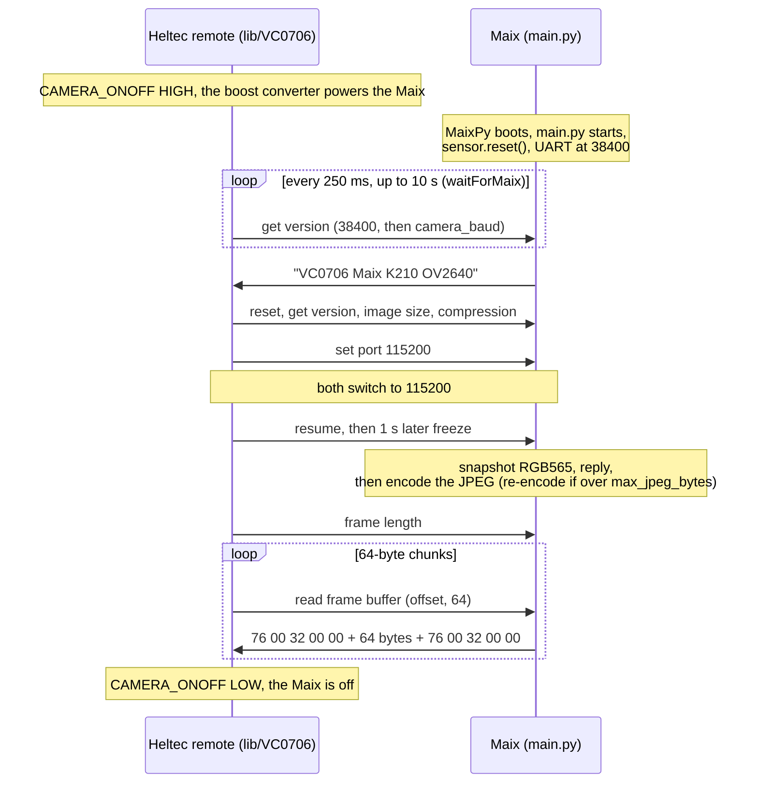

# Camera: Sipeed Maix Nano (K210)

The remote node can use a Sipeed Maix Nano (M1n module, Kendryte K210) and its DVP camera (it ships with a GC0328; an OV2640 also works) instead of the Adafruit 613. The Maix runs MaixPy and [`camera/maix/main.py`](../camera/maix/main.py), which answers the VC0706 serial protocol exactly as the Adafruit library in `lib/VC0706` sends it. The remote firmware drives it with the same library calls as the Adafruit 613, so the radio, protocol, base station and server are unchanged. Build the remote with `camera_type = maix` ([configuration.md](configuration.md#camera)).

**Status: bench-tested on a Heltec V2 (2026-10-27).** GC0328 camera, the Maix powered from its own USB-C, running MaixPy v0.6.0: pictures at 320×240 transferred over LoRa and arrived clean and byte-exact, the readout verified against the FNV-1a hash both nodes log ([Measurements](#measurements)). **The GC0328 tops out at 320×240** (see [MaixPy version](#maixpy-version)); the half-frame experiments ran on the factory v0.5.0 and on v0.6.3. Not yet tested: the V4-R8 (`remote` environment), power from the boost converter, PIR wake-up with the Maix, an OV2640 sensor. The emulator and `tools/vc0706_probe.py` have only been run against each other on a PC, with stand-ins for MaixPy's `sensor`, `machine.UART` and `fpioa_manager` modules. The `remote` and `remote_v2` environments build with `camera_type = maix`. Run the tests below in order; each must pass before the next.

Wiring, BOM and power: [hardware.md](hardware.md#camera-sipeed-maix-nano). MaixPy for the K210 is in maintenance mode ([below](#maixpy-version)).

## How it works



Between commands, main.py keeps taking frames (like the VC0706's live video), so auto-exposure follows the scene and the boot warm-up frames (`warmup_frames`) are used up while the Heltec configures it. A freeze waits for any warm-up frames still due, captures one frame and replies; the JPEG is encoded after the reply, while the Heltec waits ~0.2 s before asking for the length.

| Command | Library call (remote firmware) | Maix reply and action |
|---|---|---|
| `0x26` reset | `reset()` in `resetCamera()` | `76 00 26 00 00`, then back to 38400 baud, compression 54, frame dropped. The image size is kept (the VC0706 keeps it in EEPROM) |
| `0x11` get version | `getVersion()` | `76 00 11 00 5F` + `VC0706 Maix K210 <sensor>`, zero-padded to 100 bytes (see below) |
| `0x31` write data | `setImageSize()`, `setCompression()` | `76 00 31 00 00`. Image size `0x00`/`0x11`/`0x22` → VGA/QVGA/QQVGA; compression register → JPEG quality |
| `0x30` read data | `getImageSize()`, `getCompression()` (not used by the firmware; the probe checks them) | `76 00 30 00 01 <value>` |
| `0x24` set port | `setBaud115200()` in `speedUpCamera()` | `76 00 24 00 5F`, zero-padded to 100 bytes, sent at the old speed; then the new speed (9600–115200) |
| `0x36` frame buffer control | `resumeVideo()` (`03`), `takePicture()` (`00`) | `76 00 36 00 00`. Freeze captures and encodes; resume drops the frame |
| `0x34` frame buffer length | `frameLength()` | `76 00 34 00 04` + JPEG length, 32-bit big-endian |
| `0x32` read frame buffer | `readPicture(64)` | `76 00 32 00 00` + the requested bytes at any offset + `76 00 32 00 00` |

A command that fails (no sensor, no frame, an unknown register) gets status `04` (`76 00 <cmd> 04 00`), which the library treats as a failure. Bytes that don't form one of these commands are skipped.

**Why the padding.** `getVersion()` and the `setBaud*()` calls read until their 100-byte buffer is full or the line has been quiet for 2 s. A real VC0706 sends 16 or 5 bytes, so each of these calls costs 2 s. main.py pads both replies to exactly 100 bytes, so they return as soon as the reply arrives: about 6 s less per picture than with the Adafruit 613 [estimate], and the 250 ms boot polls work. The Heltec only reads the text up to the first zero byte.

**Compression → JPEG quality.** main.py treats the compression register as a quantisation scale with 54 (the VC0706 default) = JPEG quality 50, and inverts the IJG quality scale: register ≥ 54 → quality 2700 / register; below 54 → quality 100 − 50 × register / 54. Then it adds `quality_offset` and clamps to 10–90. The table is in [configuration.md](configuration.md#maix-nano-jpeg-quality).

**Re-encoding to fit.** If the JPEG is over `max_jpeg_bytes` (default 60000, under the V2's 72000-byte buffer), main.py encodes the same frame again at a lower quality (scaled by how far over it is, at least 5 lower) until it fits, down to quality 10, for at most 1.5 s: the Heltec waits about 2 s for the length. It uses `img.compressed()`, which leaves the RGB565 frame intact; MaixPy's `img.compress()` overwrites the frame with the JPEG ([`py_image.c`](https://github.com/sipeed/MaixPy-v1/blob/master/components/micropython/port/src/omv/py/py_image.c)), so it's only used as a fallback when the heap can't hold a second copy, and then no re-encode is possible. A JPEG still over the limit is served anyway; the V2 drops frames over 72000 bytes.

**Log.** main.py prints a timestamped line (`[maix 3120 ms] …`, milliseconds since the K210 started) for each step on the **USB REPL only** (IO4/IO5, 115200 baud): config, sensor ID and reset time, the first command, end of warm-up, baud changes, compression → quality, capture and encode times, each JPEG size, the JPEG's FNV-1a hash when the readout starts, and the readout time. Nothing but VC0706 replies goes out on IO6/IO8.

## Files

| File | Where it goes | What it is |
|---|---|---|
| `camera/maix/main.py` | `/flash/main.py` on the Maix | The VC0706 emulator. UART pins are the constants `PIN_TX = 6`, `PIN_RX = 8` at the top |
| `camera/maix/maix_config.py` | `/flash/maix_config.py` (optional) | Settings, below. Missing file = defaults |
| `tools/vc0706_probe.py` | your PC | Runs the remote firmware's command sequence through a USB-to-TTL adapter and saves the JPEG |

`maix_config.py` settings:

| Setting | Default | Meaning |
|---|---|---|
| `max_jpeg_bytes` | `60000` | Largest JPEG served; bigger ones are encoded again at a lower quality |
| `framesize` | `None` | `None` = the resolution the Heltec asks for (`maix_resolution`); `"VGA"`, `"QVGA"` or `"QQVGA"` = always this one |
| `quality_offset` | `0` | Added to the quality derived from `camera_compression`, before clamping to 10–90 |
| `vflip`, `hmirror` | `False` | Flip the sensor image vertically / mirror it horizontally |
| `warmup_frames` | `10` | Frames discarded after boot before the first picture, for auto-exposure and white balance |

## MaixPy version

Use **MaixPy-v1 v0.6.0** with the GC0328 (bench-verified: full frames at every row). **Do not use v0.6.3**: its GC0328 driver fills only the top half of every frame at every resolution (the rest is neutral gray), and the factory v0.5.0-125 leaves stale frame-buffer memory in the bottom half of its upscaled VGA. Downloads from [dl.sipeed.com](https://dl.sipeed.com/shareURL/MAIX/MaixPy/release/master) (folder `maixpy_v0.6.0_…`; the plain `.bin` fits the Nano — the `_amigo`/`_twatch`/`_m5stickv` variants are other boards' builds), flashed with [kflash_gui](https://github.com/sipeed/kflash_gui), or from a PC with the `kflash` package: `kflash -p <port> -B kd233 <bin>` (`kd233` matches the Nano's DTR/RTS wiring; keep the default baud, the FT2232 USB drops faster rates). Note that with the GC0328, `set_framesize(VGA)` is a 2× upscale of the QVGA frame (verified: the downscaled VGA frame correlates 0.99 with the QVGA frame) — it adds no detail and quadruples the transfer, so use `320x240`; an OV2640 sensor is needed for real VGA. main.py avoids f-strings and other newer Python syntax. Sipeed now develops MaixPy v4 for its MaixCAM boards, which doesn't run on the K210; the K210 line is being phased out and MaixPy-v1 only gets occasional fixes ([Sipeed wiki](https://wiki.sipeed.com/soft/maixpy/en), [MaixPy-v1](https://github.com/sipeed/MaixPy-v1)). Keep a copy of the firmware file you tested with.

## Test 1: the Maix alone

1. **Flash MaixPy** with [kflash_gui](https://github.com/sipeed/kflash_gui): connect the Maix's USB-C port, select the MaixPy-v1 `.bin`, the board and the serial port, and flash. A build with IDE support lets MaixPy IDE connect.
2. **Check the sensor.** Connect MaixPy IDE and run:

   ```python
   import sensor, time
   sensor.reset()
   print('sensor id 0x%x' % sensor.get_id())   # 0x2642 = OV2640, 0x9d = GC0328
   sensor.set_pixformat(sensor.RGB565)
   sensor.set_framesize(sensor.VGA)
   sensor.run(1)
   sensor.skip_frames(10)
   t = time.ticks_ms()
   jpg = sensor.snapshot().compressed(quality=50)
   print('%d bytes in %d ms' % (len(jpg.to_bytes()), time.ticks_diff(time.ticks_ms(), t)))
   ```

   The frame buffer view shows the picture; the terminal shows the sensor ID and the JPEG size.
3. **Copy the files** to the Maix flash with MaixPy IDE's Tools menu: open `camera/maix/main.py` and save it to the board as `main.py`, then send `camera/maix/maix_config.py` to the board as a file (optional).
4. **Check the boot.** Disconnect the IDE, open a serial terminal on the Maix's USB port at 115200 baud and press its reset button. Expect `main.py started`, `sensor OV2640 (id 0x2642) reset in … ms`, `camera UART at 38400 baud` and `answering VC0706 commands on IO6/IO8`.
   - MaixPy runs `/sd/main.py` instead of `/flash/main.py` when a microSD card is inserted, and runs `boot.py` first: remove the card, and make sure no `boot.py` loops forever (a camera or LCD demo).
   - `sensor.reset() failed` three times: check the camera ribbon. main.py keeps answering, but every picture fails.

## Test 2: emulator check from a PC

This has to pass before any Heltec test. Wire a **3.3 V** USB-to-TTL adapter to the Nano's 8-pin header (breakout): adapter RX ← pin 6, adapter TX → pin 8, GND ↔ GND. Leave the header's VCC (the Nano's 3.3 V rail) open. Power the Maix from its USB-C port, which also shows its log.

```sh
uv run tools/vc0706_probe.py /dev/ttyUSB1 --out maix.jpg                 # 640x480, compression 54, 115200 baud
uv run tools/vc0706_probe.py /dev/ttyUSB1 --size 320x240 --out qvga.jpg
uv run tools/vc0706_probe.py --help
```

The probe runs the remote firmware's sequence with the library's timeouts: poll get-version every 250 ms for up to `--wait` seconds (10), reset, get version, image size, compression, set port 115200 + get version, resume, 1 s, freeze, frame length, 64-byte reads, resume, then reads back the image size and compression registers. It prints the time of each step, saves the JPEG and exits with status 0 only if every reply was well-formed and the file starts and ends with the JPEG markers. To time the boot, press the Maix's reset button and start the probe right away: the `first answer` row is then the boot-to-first-answer time (plus up to 250 ms).

The output of a run against the PC stand-ins (not hardware; the stand-in encoder and pseudo-terminal are faster than the K210 and a real serial line):

```
first answer                       41 ms  VC0706 Maix K210 OV2640 (at 38400 baud)
reset                             133 ms  at 38400 baud
get version                       131 ms  VC0706 Maix K210 OV2640
set image size                    284 ms  640x480
set compression                   257 ms  54
set baud + get version            262 ms  115200 baud
resume + 1 s                     1133 ms
freeze                            173 ms
frame length                      212 ms  59316 bytes
read 64-byte chunks              9824 ms  59316 bytes, 6100 bytes/s
resume                            112 ms
read back registers               254 ms  size 0x00, compression 54
saved /tmp/maixtest/default.jpg: 59316 bytes, 12.8 s in total
```

Check `maix.jpg`, and that the Maix log shows the compression → quality mapping, the capture and encode times, and `read out … bytes`.

## Test 3: Heltec V2 bench

Untested. In `platformio.ini`:

```ini
[loracamera]
camera_type = maix
motion = 0
poll_interval = 120
test_image = 0
```

`maix_resolution_v2` defaults to `320x240`. Flash with `pio run -e remote_v2 -t upload` and watch `pio device monitor`. Use `local_v2` or `local` as the base station.

1. **Maix on its own USB-C first**, wired as in the [V2 diagram](images/wiring-maix-v2.svg): 8-pin header GND to the V2's GND, pin 6 → 330 Ω → GPIO23, pin 8 ← 330 Ω ← GPIO17, the boost converter's 5 V **not** connected to the Maix (don't feed its 5V hole and USB-C at once). `CAMERA_ONOFF` then switches nothing, so the Maix stays on, at 115200 baud, between pictures; the firmware copes. Expect, on the first picture:

   ```
   Camera answered … ms after power-on, at 38400 baud: VC0706 Maix K210 OV2640
   Camera: Maix (K210) via VC0706 emulation
   Turning on camera; reset with 1
   Camera serial at 115200 baud
   len of frame is …
   camera: … bytes in …s. … bytes/s.
   ```

   On later pictures the Maix answers at 115200 (`at 115200 baud`), and `resetCamera()` spends 2 s trying 38400 before resetting it at 115200.
2. **Then from the boost converter**: unplug the Maix's USB-C and connect the boost converter's 5 V output and GND to the Nano's 5V and GND holes (left edge), never to the header's VCC. `CAMERA_ONOFF` (GPIO22) now switches the Maix, and the first answer comes after MaixPy's boot. Note the `Camera answered … ms after power-on` value.
3. Confirm the picture on the base station's SD card (`/loracam/NNNNNN.jpg`) or on the upload server.

## Test 4: Heltec V4-R8

Untested. The same with the `remote` environment (IO6 → GPIO47, IO8 ← GPIO48, `CAMERA_ONOFF` GPIO41), `maix_resolution = 640x480` (the default) and re-encoding on (`jpeg_quality = 30`, the default). Expect `Re-encoded 640x480 colour (chroma …, quality 30): N -> M bytes` after the readout.

## Measurements

Values marked [estimate] are not measured yet; the rest come from the V2 bench test (2026-10-27, GC0328, indoor scene, Maix on USB power).

| Quantity | How to measure | Expected | Measured |
|---|---|---|---|
| Boot to first answer | Remote log `Camera answered N ms after power-on` (boost converter powering the Maix), or the probe's `first answer` after a Maix reset | 2–4 s: MaixPy start-up, its 200 ms pause for the IDE, `sensor.reset()` | 2.6 s (cold boot; `sensor.reset()` 1.6 s of it) |
| Readout at 115200 baud | Remote log `camera: N bytes in Xs`, the probe's `read 64-byte chunks` row, main.py's `read out` line | each 64-byte chunk is a request and a reply, and the library polls in 10 ms steps | 5.2–5.3 KB/s (V2, 40–44 KB frames) |
| JPEG size, 640×480 (quality 50) | Remote log `len of frame is …` | 25–60 KB [estimate] | 68–75 KB (GC0328) — **but the bottom half of the frame is garbage on MaixPy v0.5.0** ([troubleshooting](#the-bottom-half-of-640x480-pictures-is-garbage)); sizes alone say nothing about validity |
| JPEG size, 320×240 (quality 50) | same | 8–20 KB [estimate] | 2.2–3.3 KB |
| JPEG size, 160×120 (quality 50) | same | 3–6 KB [estimate] | not measured |
| Current at 5 V, Maix running | USB power meter on the Maix's 5 V, during the readout | 150–300 mA [estimate]; the M1n datasheet asks for a supply of more than 300 mA | not measured |

## Troubleshooting

### `Maix didn't answer within 10000 ms`
- Run test 2: the probe must pass first.
- TX/RX crossed: Maix IO6 (TX) goes to `CAMERATX_BOARDRX` (V2 GPIO23, V4-R8 GPIO47), IO8 (RX) to `CAMERARX_BOARDTX` (V2 GPIO17, V4-R8 GPIO48). Common GND.
- The Maix has no 5 V: check that `CAMERA_ONOFF` switches the boost converter on, and that its output holds 5 V under the Maix's load.
- main.py doesn't run: a microSD card in the Maix (MaixPy then runs `/sd/main.py`), a `boot.py` that never returns, or a Python error (connect the USB REPL and press reset).
- MaixPy boots slower than 10 s: raise `MAIX_BOOT_TIMEOUT_MS` in `src/remote/main.cpp`.

### `Camera isn't the Maix emulator, but camera_type = maix`
Something answered get-version without "Maix" in its text: an Adafruit 613 on the camera wires. Build with `camera_type = vc0706` for it.

### `Couldn't take pic`, or `len of frame is 0`
The freeze or the encoding failed. The Maix log says why: `no camera sensor` (ribbon), `capture failed`, `compressed() failed`.

### Night pictures are black
The Maix has no IR LEDs and no IR-cut control; pictures at night need ambient light ([hardware.md](hardware.md#camera-sipeed-maix-nano)).

### Pictures arrive corrupted (top decodes, the rest is tiled noise)
The camera readout lost its byte alignment: a chunk reply stalled mid-way (the Maix's Python can garbage-collect between the bytes of a reply), the library still accepted it as data, and every later byte shifted. Fixed in three places: `readPicture()` in `lib/VC0706` now rejects a short reply without advancing, the remote firmware drains the camera line and re-reads the same chunk, and main.py sends each reply as one write and collects garbage before the readout instead of during it. Both logs now carry an FNV-1a over the picture: main.py prints `serving N bytes, fnv1a …` when the readout starts, the remote `camera readout hash …` after it — equal hashes mean the readout was byte-exact. A retry in between shows as `problem reading data from camera` on the remote and is normal as long as the hashes match.

### The bottom half of 640×480 pictures is garbage
With the GC0328 sensor, MaixPy's `set_framesize(VGA)` upscales the QVGA frame rather than reading more pixels, and the scaler is what breaks: the factory v0.5.0-125 leaves stale frame-buffer memory below row ~247, and v0.6.3 fills only the top half of every frame at every resolution with neutral gray below. The JPEG encoder, `compressed()`, `save()` and the transfer chain are all correct — verified by pulling JPEGs straight off the K210 over USB: the break is at the same pixel row at every quality, and two encodings of one frame share the same bottom half. Use MaixPy **v0.6.0** (full frames; see [MaixPy version](#maixpy-version)) with `maix_resolution`/`maix_resolution_v2` = `320x240` — on the GC0328, VGA is only an upscaled QVGA (0.99 correlation) with four times the airtime. Real 640×480 needs an OV2640 sensor.

### The Maix REPL ignores input while main.py runs
On MaixPy v0.5.0, typing at the USB REPL (or Ctrl-C) does nothing while a script is running, so main.py can't be stopped from the terminal. To replace it, interrupt the boot: reset the Maix and send Ctrl-C repeatedly during the first second, while `_boot.py` is still deciding to run main.py; a `KeyboardInterrupt` traceback in `_boot.py` followed by `>>>` means the board is at a clean prompt and main.py never started. Over USB, DTR on the REPL interface (the first of the two serial ports) is the reset line and RTS is the boot-mode pin.
