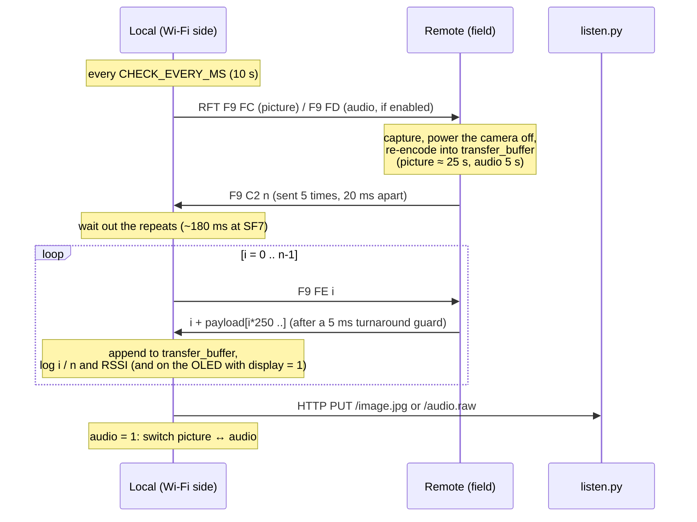

# LoRa transfer protocol

All packets are raw LoRa frames: explicit header, 2-byte CRC, sync word `0x12`. The radio settings are in [configuration.md](configuration.md#radio-link-libheltecv4r8heltecv4r8h). Multi-byte numbers are **little-endian** `uint16`, packed by `u0()`/`u1()` and unpacked by `u()` in `lib/HeltecV4R8/HeltecV4R8.h`.

## Packet types

| Name | Direction | Length | Bytes |
|---|---|---|---|
| Request for transmission (RFT) | local → remote | 2 | `F9 FC` = picture, `F9 FD` = audio (only sent and answered when built with `audio = 1`) |
| RFT response | remote → local | 4 | `F9 C2 nL nH`, where `n` = number of data packets |
| Packet request | local → remote | 4 | `F9 FE iL iH`, where `i` = packet index, starting at 0 |
| Data packet | remote → local | 3–252 | `iL iH` + up to 250 payload bytes |

The remote node tells packet types apart by **length** (2 or 4 bytes) and then checks the leading bytes. Anything else is ignored.

Every data packet carries `LORA_TRANSFER_BUFFER` (250) payload bytes. The last one carries `content_length % 250` bytes, unless the content is an exact multiple of 250. `n = ceil(content_length / 250)`.

## Sequence

## Timeouts and retries (local node)

| Phase | Wait | Retries | Worst case |
|---|---|---|---|
| RFT → RFT response | `MAX_RFT_RESPONSE_MS` = 30 s | `REQUEST_TIMER` = 200 | ~100 min, then `Request timer timed out`. The next RFT goes out right away (the 10 s interval is counted from the start of the previous attempt) |
| Packet request → data packet | `RESPONSE_TIMER` × ~20 ms ≈ 4 s | `REQUEST_TIMER` = 200, resent right after each timeout | ~14 min per packet. The packet is then **skipped**, and the uploaded file is shorter and corrupted |

Filtering on the local node while waiting for data:

- 4-byte frames starting with `F9`, i.e. the repeated RFT responses, are discarded as "magic packet".
- Frames whose index doesn't match the requested one are discarded as "Mismatched packet". The same request is resent on the next attempt.
- Frames shorter than 2 bytes or longer than 252, and frames that would overflow the 125 KB receive buffer, are discarded as "Malformed packet".
- Frames with a bad CRC are dropped by the radio layer (`LoRa receive error: -7`).

The remote node is stateless between requests. It serves any packet index from its last capture, so a lost packet only costs a re-request. Requests for an index past the end of the capture are ignored.

## Edge cases

- **Capture failed:** if the camera can't take a picture, `content_length` is 0 and the remote answers `F9 C2 00 00`. The local node treats 0 packets as "nothing to do" and asks for a picture again after `CHECK_EVERY_MS`. With `audio = 1` it doesn't switch to audio in that case.
- **Audio request to a picture-only remote:** a remote node built with `audio = 0` ignores `F9 FD` entirely. Build both nodes with the same `audio` value.
- **Remote busy:** the remote handles one request at a time and doesn't listen while it captures (up to ~25 s for a picture). The local node waits up to `MAX_RFT_RESPONSE_MS` for the answer.
- **Short last packet:** if the last packet has only 1–2 payload bytes (total length < 5) and the low byte of its index is `0xF9`, the local node mistakes it for an RFT response and discards it. That only happens when `content_length % 250` is 1 or 2 and `n − 1 ≡ 249 (mod 256)`. It's rare, and it costs the last 1–2 bytes.
- **Upload:** the HTTP status of the PUT is not checked. If the server is down, that capture is lost.

## Throughput

One data packet takes:

| Step | Time at SF7 / 250 kHz |
|---|---|
| Request airtime (4 bytes) | 15 ms |
| Remote poll interval (`delay(20)` in `loop()`), average | ~10 ms |
| Remote turnaround guard | 5 ms |
| Data airtime (252 bytes) | 197 ms |
| Local poll interval, average | ~10 ms |
| **Total** | **≈ 0.24 s → ≈ 1 KB/s** |

That puts a 48 KB camera JPEG at about 46 s, a 20 KB re-encoded one at about 19 s, and 5 s of audio (≈ 110 KB) at about 1.8 min. These are calculated estimates, not measurements. The data packet's airtime is now about 83% of the cycle. Further speed has to come from fewer bytes (re-encoding, resolution) or radio settings (bandwidth, SF).

Earlier versions waited a fixed 100 ms before every request and again before every reply (~0.45 s per packet). Those delays were inherited from the original Heltec V2 code and have been removed. `radioSend()` puts the SX1262 back into receive mode as soon as each transmission ends. The remote's 5 ms guard covers that turnaround, and the one-time wait after the RFT response keeps the first request from colliding with the remote's repeated replies. The shorter timing hasn't been tested on hardware yet.
