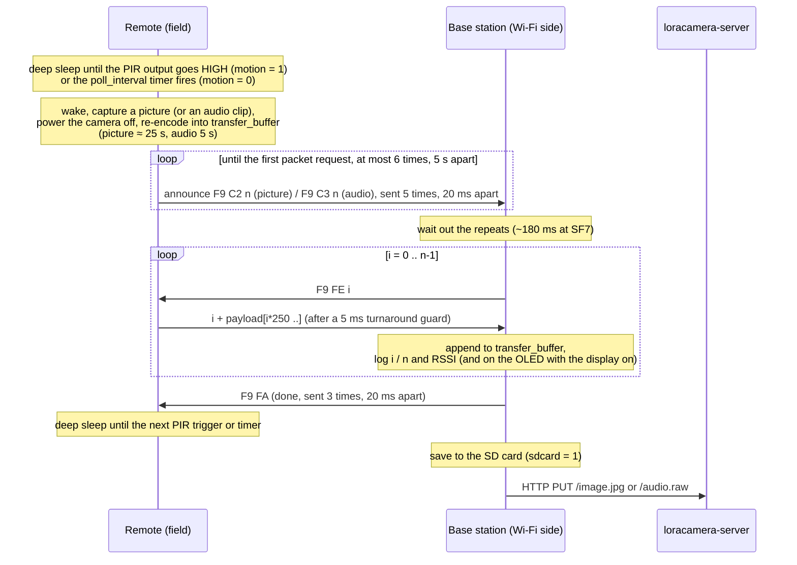

# LoRa transfer protocol

All packets are raw LoRa frames: explicit header, 2-byte CRC, sync word `0x12`. The radio settings are in [configuration.md](configuration.md#radio-link). Multi-byte numbers are **little-endian** `uint16`, packed by `u0()`/`u1()` and unpacked by `u()` in `lib/Board/Board.h`. The Heltec V4-R8 (SX1262) and the Heltec V2 (SX1276) use the same on-air format and sync word, so nodes on either board interoperate. Mixed pairs have not been tested on hardware.

There is one protocol, whatever the `motion` setting. **The remote node always starts a transfer** (it wakes on its PIR or its timer, captures, and announces what it has); **the base station only listens** and pulls the capture packet by packet. The base station never transmits on its own. Both nodes must run this protocol version: a base station on older firmware doesn't answer the announcements, and the remote drops the capture.

## Packet types

The byte values are the `PKT_*` constants in `lib/Board/Board.h`.

| Name | Constant | Direction | Length | Bytes |
|---|---|---|---|---|
| Announcement, picture | `PKT_MAGIC`, `PKT_ANNOUNCE_PICTURE` | remote → base | 4 | `F9 C2 nL nH`, where `n` = number of data packets |
| Announcement, audio | `PKT_MAGIC`, `PKT_ANNOUNCE_AUDIO` | remote → base | 4 | `F9 C3 nL nH`. Only with `audio = 1` |
| Packet request | `PKT_MAGIC`, `PKT_REQUEST` | base → remote | 4 | `F9 FE iL iH`, where `i` = packet index, starting at 0 |
| Data packet | | remote → base | 3–252 | `iL iH` + up to 250 payload bytes |
| Done | `PKT_MAGIC`, `PKT_DONE` | base → remote | 2 | `F9 FA`: transfer finished, the remote can sleep |

The remote node tells packet types apart by **length** (2 or 4 bytes) and then checks the leading bytes. Anything else is ignored. The base station accepts only a 4-byte frame starting `F9 C2` or `F9 C3` as the start of a transfer.

The earlier request-for-transmission packets (`F9 FC`, `F9 FD`) and the polling mode that used them are gone. The remote ignores them, and a base station can no longer start a transfer.

Every data packet carries `LORA_TRANSFER_BUFFER` (250) payload bytes. The last one carries `content_length % 250` bytes, unless the content is an exact multiple of 250. `n = ceil(content_length / 250)`.

## Transfer

What starts the wake-up depends on `motion` ([configuration.md](configuration.md#motion-detection-pir-and-the-timer)):

- **`motion = 1`:** the PIR output goes HIGH. Power-on or reset only arms the PIR; no picture is taken until it triggers.
- **`motion = 0`:** the deep-sleep timer, every `poll_interval` seconds after the previous capture ended. The remote also captures once right after power-on or reset, which confirms the link when installing.

The base station is always in receive mode, so it picks up an announcement whenever it's up, including during the first `WIFI_CONNECT_TIMEOUT_MS` after boot, thanks to the repeated announcements. "Done" goes out before the SD write and upload, so the remote sleeps as early as possible. A capture that is too big for the base station's buffer is announced, never requested, and still answered with "done".

With `audio = 1` the remote alternates between a picture (`F9 C2`) and an audio clip (`F9 C3`), one per wake-up. The base station maps the announced type to the upload URL and file extension.

## Timeouts and retries

On the base station:

| Phase | Wait | Retries | Worst case |
|---|---|---|---|
| Packet request → data packet | `RESPONSE_TIMER` × ~20 ms ≈ 4 s per attempt | the request is resent after each timeout, until `PACKET_GIVE_UP_MS` = 20 s | 20 s. The rest of the transfer is then **abandoned** (`Remote stopped answering; abandoning the transfer at packet N`), and the file is saved and uploaded truncated. "Done" is sent anyway |
| After the announcement | the repeats' airtime, `ANNOUNCE_REPEAT` × (4-byte airtime + `ANNOUNCE_REPEAT_GAP_MS`) | none | ~180 ms at SF7 |
| "Done" | `DONE_REPEAT` = 3 sends, `ANNOUNCE_REPEAT_GAP_MS` = 20 ms apart | none | ~60 ms |

On the remote node:

| Phase | Limit | Then |
|---|---|---|
| Announcement → first packet request | `ANNOUNCE_TRIES` × `ANNOUNCE_GAP_MS` = 6 × 5 s, each announcement sent `ANNOUNCE_REPEAT` = 5 times, `ANNOUNCE_REPEAT_GAP_MS` = 20 ms apart | `The base station never answered; picture dropped` (or `audio`), back to sleep |
| Between packet requests | `SERVE_IDLE_MS` = 30 s | `No request for 30 s, stopping`, back to sleep. Only happens when all three "done" packets are lost, or the base station gave up |

`SERVE_IDLE_MS` must exceed `PACKET_GIVE_UP_MS`; the build checks it.

Filtering on the base station while waiting for data:

- 4-byte frames starting with `F9`, i.e. the repeated announcements, are discarded as "magic packet".
- Frames whose index doesn't match the requested one are discarded as "Mismatched packet". The same request is resent on the next attempt.
- Frames shorter than 2 bytes or longer than 252, and frames that would overflow the receive buffer (`MAX_TRANSFER_BUFFER`: 125000 bytes on the V4-R8, 72000 on the V2), are discarded as "Malformed packet".
- Frames with a bad CRC are dropped by the radio layer (`LoRa receive error: -7`).

The remote node is stateless between requests. It serves any packet index from its last capture, so a lost packet only costs a re-request. Requests for an index past the end of the capture are ignored.

**Announcement larger than the base station's buffer.** When the base station receives an announcement, it checks `n × 250` against its own `MAX_TRANSFER_BUFFER`. If the capture doesn't fit (for example a V4-R8 remote, 125000 bytes, talking to a V2 base station, 72000 bytes), it logs `N packets don't fit this board's M-byte buffer; skipped` and requests no packets. It still sends "done", so the remote goes to sleep.

## Edge cases

- **Capture failed:** if the camera can't take a picture, `content_length` is 0. The remote logs `Nothing to send`, announces nothing, and goes back to sleep. With `audio = 1` the picture/audio alternation doesn't advance, and with `motion = 0` the next attempt is a full `poll_interval` later. (An announcement with 0 packets is ignored by the base station.)
- **Base station busy or down:** the remote repeats the announcement every 5 s, up to 6 times (~30 s). A base station that is saving or uploading the previous file during that time (an upload can take several seconds), or still booting, catches a later repeat. After that the remote drops the capture and sleeps.
- **Motion during a transfer (`motion = 1`):** the remote is awake and busy, so the PIR isn't watched. If its output is still HIGH when the remote goes back to sleep, the next picture follows at once; a shorter movement in between is missed.
- **Remote busy:** the remote doesn't listen while it captures (up to ~25 s for a picture) and between wake-ups it is asleep, so it never hears anything the base station sends then. That's harmless: the base station sends only in answer to an announcement.
- **Short last packet:** if the last packet has only 1–2 payload bytes (total length < 5) and the low byte of its index is `0xF9`, the base station mistakes it for an announcement repeat and discards it. That only happens when `content_length % 250` is 1 or 2 and `n − 1 ≡ 249 (mod 256)`. It's rare, and it costs the last 1–2 bytes.
- **Upload:** a failed PUT (no Wi-Fi, server down, non-2xx status) is logged but not retried. With `sdcard = 1` the file was already saved to the SD card first, so it isn't lost.

## Throughput

One data packet takes:

| Step | Time at SF7 / 250 kHz |
|---|---|
| Request airtime (4 bytes) | 15 ms |
| Remote poll interval (`delay(20)` in the serve loop), average | ~10 ms |
| Remote turnaround guard | 5 ms |
| Data airtime (252 bytes) | 197 ms |
| Base station poll interval, average | ~10 ms |
| **Total** | **≈ 0.24 s → ≈ 1 KB/s** |

That puts a 48 KB camera JPEG at about 46 s, a 20 KB re-encoded one at about 19 s, and 5 s of audio (≈ 110 KB) at about 1.8 min. These are calculated estimates, not measurements. The data packet's airtime is now about 83% of the cycle. Further speed has to come from fewer bytes (re-encoding, resolution) or radio settings (bandwidth, SF).

Earlier versions waited a fixed 100 ms before every request and again before every reply (~0.45 s per packet). Those delays were inherited from the original Heltec V2 code and have been removed. `radioSend()` puts the radio back into receive mode as soon as each transmission ends. The remote's 5 ms guard covers that turnaround, and the one-time wait after the announcement keeps the first request from colliding with the remote's repeated announcements. The shorter timing hasn't been tested on hardware yet.
